<h1 align="center">Code[Dock]</h1>

  <b>Your coding agents, in the notch.</b> 
  Approve, answer and jump back to every AI coding session — without leaving what you're doing.

  <a href="https://github.com/miguelriotinto/codedock-app/releases/latest"><b>⬇︎ Download for Mac</b></a>
  &nbsp;·&nbsp; free &nbsp;·&nbsp; macOS 26 or later, Apple silicon

  
  
  
  

  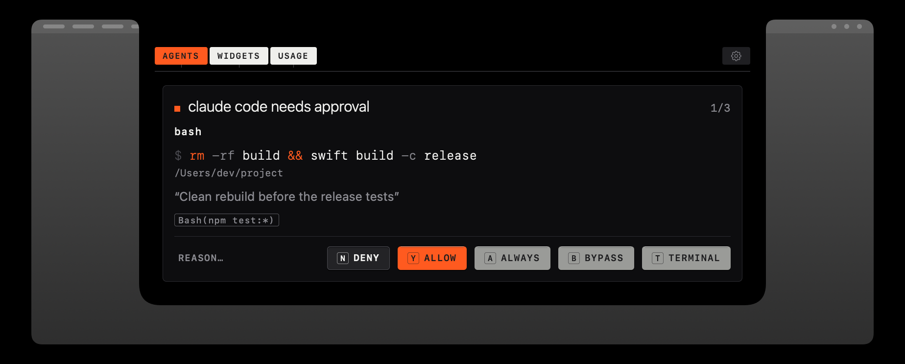

Code[Dock] lives at the top of your screen — under the notch, or as a slim capsule in the menu bar
on displays without one. It knows what every coding agent on your Mac is doing, puts the moments
that need you right where you're already looking, and stays out of the way the rest of the time.

<table>
  <tr>
    <td width="33%"><b>✅ Approve in place</b> Allow or deny a tool call from the notch, by click or key.</td>
    <td width="33%"><b>🧭 Every agent, one list</b> Claude Code, Codex, Gemini, Cursor and more, live.</td>
    <td width="33%"><b>↩︎ Jump back</b> One click to the exact terminal tab, split or tmux pane.</td>
  </tr>
  <tr>
    <td><b>📊 Know your limits</b> 5-hour and weekly usage, before you hit them.</td>
    <td><b>🗓 Your day, too</b> Calendar, Reminders, Notes, news, music and a Pomodoro timer.</td>
    <td><b>🔒 Private by design</b> Local only. No account, no server, no telemetry.</td>
  </tr>
</table>

---

## Always at a glance

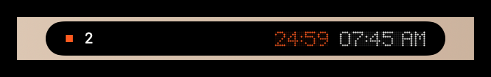

Closed, Code[Dock] is a slim capsule in the menu bar — or a black extension of the notch. The time
sits on the right in LED digits, its colon blinking each second. A running Pomodoro counts down
beside it in orange, music plays its spectrum, and one orange lamp lights up the moment an agent
needs you. Hover, click or press your hotkey and the whole panel drops open.

## Every agent, one list

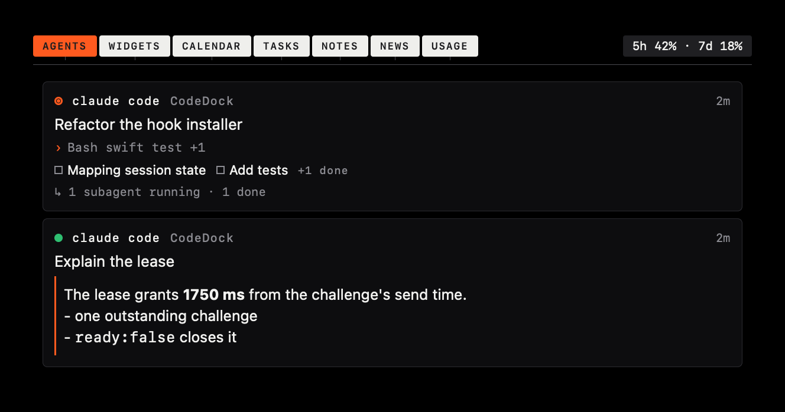

Each session shows its status at a glance: a moving mark while it works, one orange lamp when it
needs you, its latest prompt, the tool it's running, its task checklist and subagents. When a turn
ends, the answer is right there, rendered as Markdown. Click a session to jump straight back to its
terminal — the exact tab, split or tmux pane.

Works with **Claude Code, Codex, Gemini CLI, Cursor, Copilot CLI, OpenCode, Kiro, Devin / Windsurf,
Qwen Code, Droid** and more — plus any agent you describe yourself. Sessions on remote machines over
SSH and in Docker containers show up the same way.

## Approve and answer without switching windows

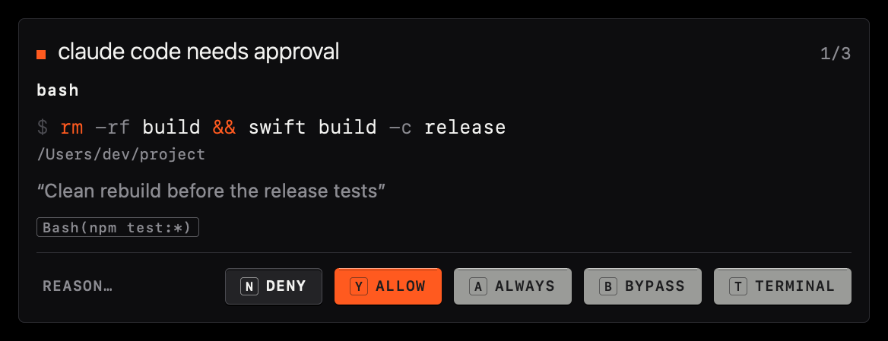

The panel opens on its own when an agent asks for permission: the exact command or diff, where it
runs, and why. Press **Y** to allow, **N** to deny, or tell the agent what to do instead. Questions
and plan reviews work the same way, so an agent never waits on a terminal you can't see.

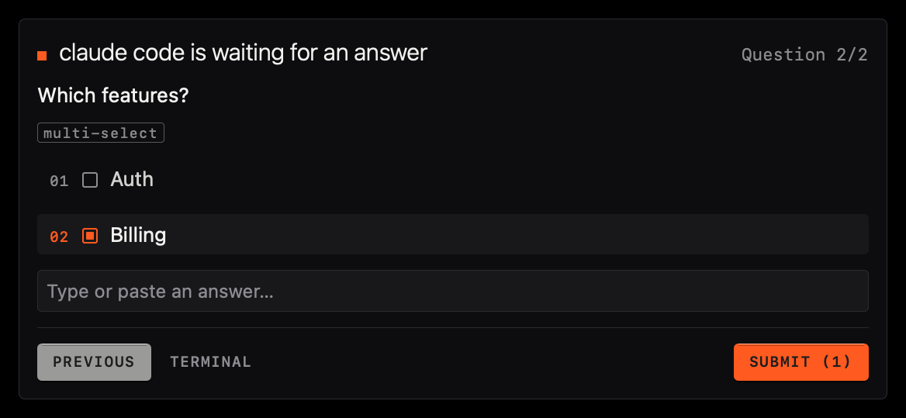

## Know your limits

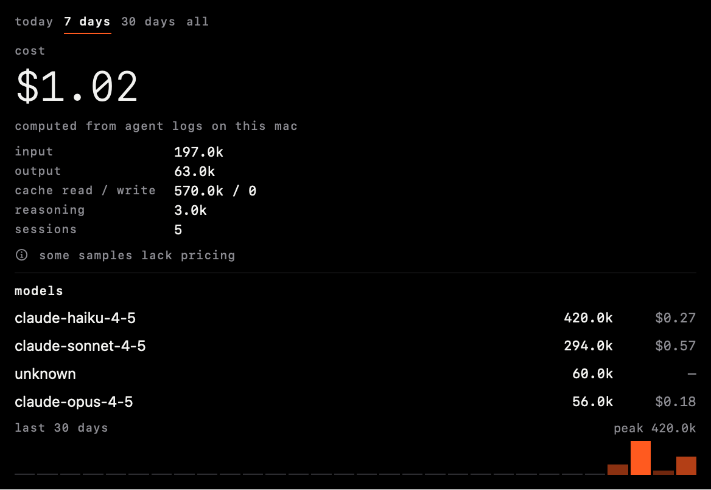

Your Claude and Codex limits ride along in the tab strip; the Usage tab shows what you've spent this
week, day by day and per agent. All of it is read from your agents' own local logs.

## Your day, in the same place

<table>
  <tr>
    <td width="50%">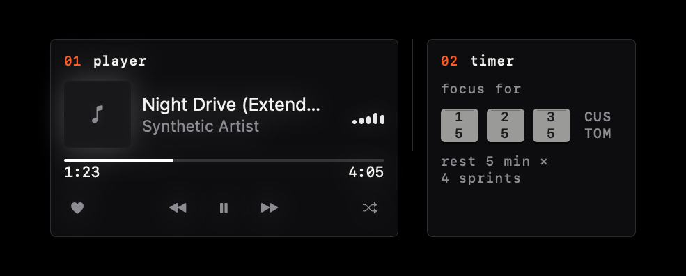 <b>Widgets</b> — control Apple Music or Spotify, and start a 15, 25 or 35-minute focus session with one key.</td>
    <td width="50%">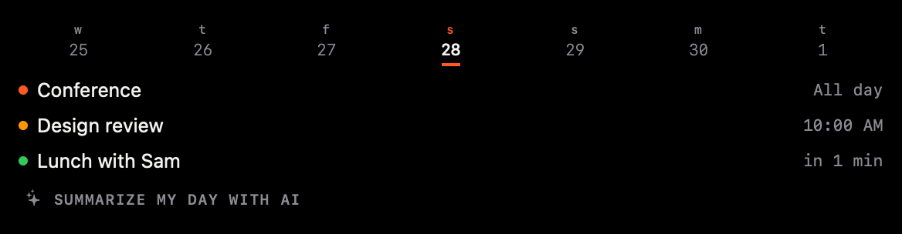 <b>Calendar</b> — the week at the top, today's events below, and an on-device summary of your day.</td>
  </tr>
  <tr>
    <td>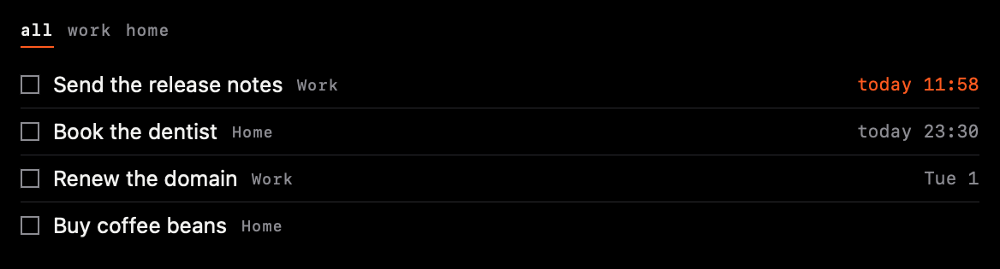 <b>Tasks</b> — your Apple Reminders, list by list. Tick one off without opening Reminders.</td>
    <td>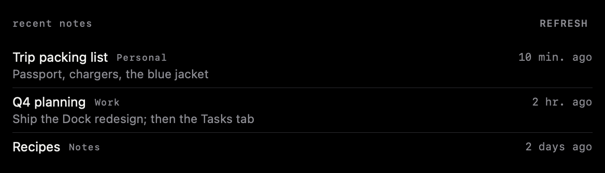 <b>Notes</b> — the notes you changed most recently, one click from opening.</td>
  </tr>
  <tr>
    <td>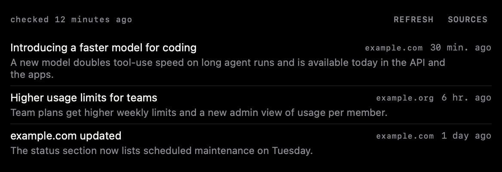 <b>News</b> — follow any website or feed; what's new is summarized on your Mac.</td>
    <td>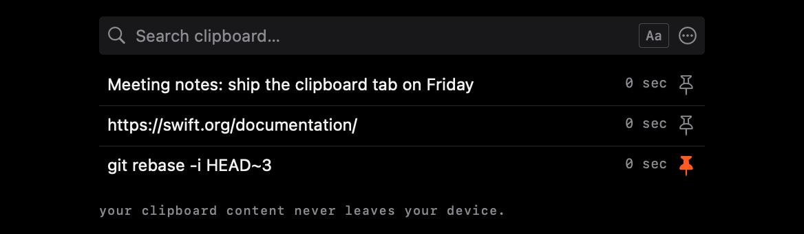 <b>Clipboard &amp; Tray</b> — a searchable, pinnable history, and a tray to drop files on and AirDrop from.</td>
  </tr>
</table>

## Set up in a minute

<table>
  <tr>
    <td width="50%">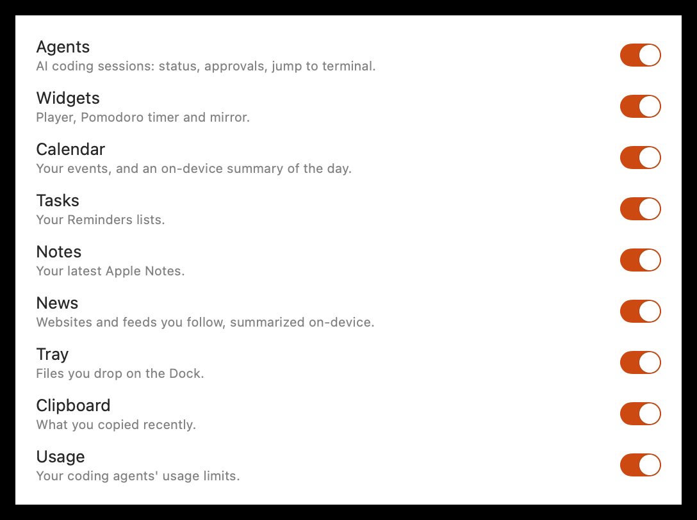</td>
    <td width="50%">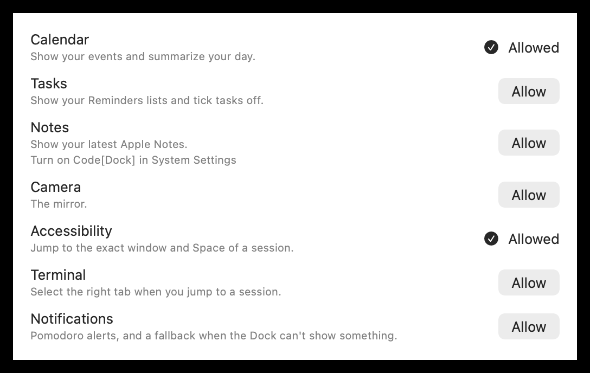</td>
  </tr>
</table>

Pick the tabs you want — only those show in the Dock. Then allow what they need, one **Allow**
button each. Change either any time in **Settings › Display** and **Settings › Permissions**.

## Designed like an instrument

Code[Dock] draws its panel like a small piece of hardware: a strip of labelled tabs, a black display
for content, and physical keys — orange to allow, black to deny, grey for the rest. One accent
colour, and it only appears when something needs you. The panel opens like a lid, from the top edge
down.

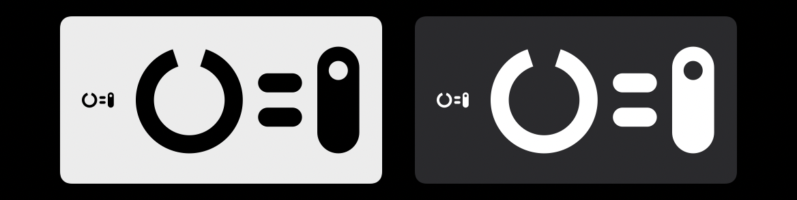

In the menu bar it's the top detail of the app icon — the ring, the bars and the pill — drawn the
same way as the rest of the Code[] family.

## Private by design

- **Local only.** No account, no server, no analytics. Code[Dock] talks to your agents through local
  hooks and a socket on your Mac.
- **Asks first.** Calendar, Reminders, Notes, the camera and every other permission stay off until
  you press **Allow**, and each can be turned off again in System Settings.
- **Touches only its own.** It adds its hooks to your agents' configs, never edits anything else
  there, and removes them cleanly.
- **On-device AI.** Summaries use Apple Intelligence on your Mac, when it's available.

## Install

1. Download **CodeDock-&lt;version&gt;.dmg** from the [latest release](https://github.com/miguelriotinto/codedock-app/releases/latest).
2. Open it and drag **Code[Dock]** onto **Applications**.
3. Launch it. A short setup asks which tabs you want, connects your agents and lets you allow what they need.

Code[Dock] is signed with a Developer ID and notarized by Apple, and keeps itself up to date: new
versions arrive through the EdDSA-signed `appcast.xml` attached to each release.

**Requires macOS 26 or later on an Apple silicon Mac.**

## Questions

<b>Do I need a notch?</b>

No. On a display without a notch Code[Dock] sits in the menu bar as a slim capsule, at the menu
bar's height, and you can float it anywhere on screen instead.

<b>Does it send my code or prompts anywhere?</b>

No. Everything stays on your Mac: sessions, approvals, usage, calendar, notes and clipboard. There
is no account and no server.

<b>Which agents does it support?</b>

Claude Code, Codex, Gemini CLI, Cursor, Copilot CLI, OpenCode, Kiro, Devin / Windsurf, Qwen Code
and Droid, plus custom agents you describe — locally, over SSH or in Docker.

<b>How do I remove it?</b>

Settings › About › **Remove All** takes its hooks out of your agents' configs; then drag the app
to the Trash.

---

  Code[Dock] · part of the Code[] family with <a href="https://github.com/miguelriotinto/CodeRelay">Code[Relay]</a> and <a href="https://github.com/miguelriotinto/codewhisper-app">Code[Whisper]</a>

